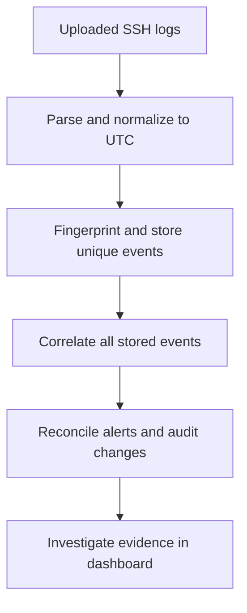

# Architecture and design decisions

## Processing flow

## Data model

| Table | Purpose |
|---|---|
| imports | File identity, original name and rejected-line details |
| events | Canonical event, original first raw line, semantic fingerprint |
| import_events | Many-to-many relationship between uploaded files and unique events |
| alerts | Current and historical incidents, linked event IDs, rule snapshot and active flag |
| settings | Schema marker and current detection settings |
| audit | Alert creation, changed evidence, rule application and status updates |

Foreign keys link ingestion records. Alert evidence IDs are stored as JSON to keep the project small;
a normalized alert_events table would permit stronger referential constraints and faster evidence joins.
Indexes cover event fingerprints, timestamps, and host/source/time.

## Ingestion transaction

Parsing occurs before opening the write transaction. BEGIN IMMEDIATE serializes writers.
One transaction stores the import, inserts unique events, records provenance, evaluates all events,
and updates alerts. A failure rolls the operation back. Parameterized queries handle user data;
the few interpolated table names are validated against a fixed allowlist.

## Two levels of identity

File SHA-256 includes bytes and timestamp interpretation settings. It avoids repeated import work.
Event SHA-256 includes normalized fields, authentication method and source port.
It prevents overlapping files from artificially increasing failure counts.
Hash collisions are negligible for this project; ambiguity in coarse log timestamps is the practical limitation.

## Correlation

The detector sorts events by UTC timestamp and maintains deque windows for:
host/IP failures, host/IP distinct failed accounts, and host/IP/username preceding failures.
Events older than a window are removed from the queue. The boundary itself remains included.

Destination hostname prevents unrelated servers from being combined.
Successful attempts do not contribute to the distinct-failed-usernames rule.
Multiple rules may describe the same activity; they are separate findings, not separate proven attacks.

Sorting costs O(n log n). Window maintenance is amortized O(n), but checking distinct usernames
scans that active queue, and constructing initial evidence costs its window size.
Therefore the complete detector is not strictly O(n); dense windows increase work and memory.
Merged incidents accumulate evidence IDs once per new matching event.

## Alert lifecycle

Identity is SHA-256(rule, correlation group, first evidence timestamp).
Extending a burst keeps the ID when the anchor stays the same.
Reanalysis marks prior alerts inactive, then upserts the current findings.
Unchanged evidence and rule snapshots preserve the investigation status.
Changed evidence or settings resets affected current alerts to New and records the reason.
A late event that moves the anchor produces a new ID; the old row remains inactive.
This intentionally favors review of new evidence over silently preserving a resolved decision.

## Tradeoffs and next steps

SQLite gives a reproducible local setup and atomic writes, with one concurrent writer.
All stored events are reprocessed for correctness under late uploads.
An incremental service would need durable checkpoints, bounded lateness/watermarks, and incident reconciliation.
For production: authenticated users, append-only remote audit storage, retention, ingestion authentication,
background processing, normalized evidence relations, stronger input normalization and operational monitoring.
